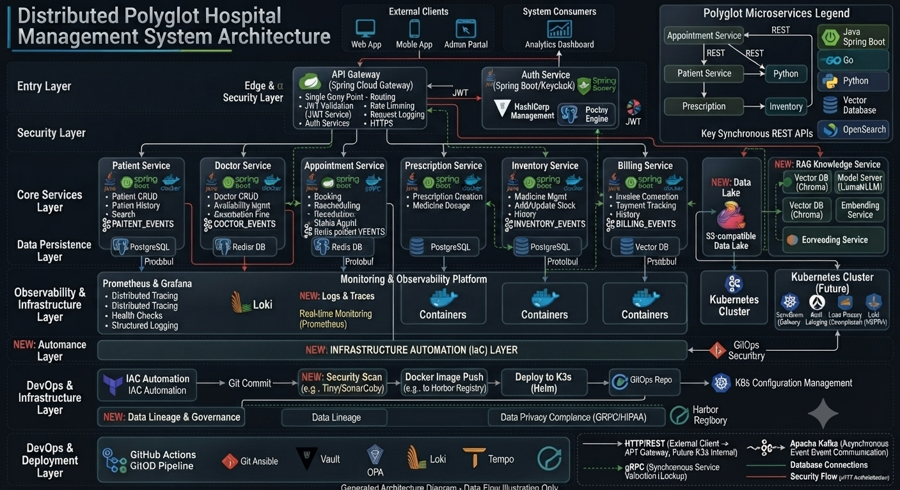

<div align="center">


[](https://github.com/HariDev-eng)
[](https://www.linkedin.com/in/hari-pradap-490663260/)


</div>

<br>

## 🚀 About Me

I'm a backend engineer who builds distributed systems and cares about **why** software is designed the way it is, not just whether it works.

I hold a **B.Tech in Information Technology** and completed a **10-month internship at Marmin Technologies**, where I worked on REST APIs, financial document workflows, webhook delivery systems, RabbitMQ, a SaaS compliance platform, PostgreSQL, and Go backend services.

I learn by building real systems, breaking them on purpose, and documenting what I find: failure tests, trade-offs, and design decisions.

> *Learn by Building • Improve by Breaking • Understand by Documenting*

<br>

## ⚡ Flagship Project: OpsPilot

**An incident detection and response platform.** OpsPilot turns raw production events into incidents, so engineers see one meaningful alert instead of hundreds of noisy ones.

```
HTTP → Event API → PostgreSQL (events + outbox) → Outbox Publisher → Kafka
     → Incident Consumer → Redis sliding-window detection → Incident (PostgreSQL)
     → Redis state projection → (next) Context Builder → RAG → LLM analysis → Human approval
```

### What's built

| Capability | Details | Status |
|---|---|:---:|
| 📥 Event ingestion | Idempotent ingestion with a database-enforced unique event ID | ✅ |
| 📤 Transactional Outbox | Event and outbox row written in one PostgreSQL transaction | ✅ |
| 🔁 Outbox Publisher | Publishes to Kafka, using `FOR UPDATE SKIP LOCKED` to coordinate multiple publishers | ✅ |
| 📨 Kafka consumers | Consumer groups, offset management, partition keys by service | ✅ |
| 🧱 Idempotent processing | `processed_events` table prevents duplicate incidents on redelivery | ✅ |
| 🪟 Sliding-window detection | Redis Sorted Set + atomic Lua script (e.g. 5 failures in 10 seconds) | ✅ |
| 🗄️ Incident lifecycle | PostgreSQL as source of truth, Redis as a fast-read projection | ✅ |
| ♻️ Retries + DLQ | Retry with backoff, then Dead Letter Queue on permanent failure | ✅ |
| 🧠 Context builder + RAG | Retrieve relevant runbooks and past incidents | 🚧 |
| 🤖 LLM incident analysis | Structured, evidence-backed root-cause analysis | 🚧 |
| ✅ Human-in-the-loop approval | AI recommends, humans approve before any action | 📅 Planned |
| 🐳 Docker / Kubernetes | Containerized deployment | 📅 Planned |

### Engineering decisions I documented

- **Event ≠ Incident.** One failed payment is an event; a burst of failures is an incident.
- **Transactional Outbox + idempotent consumers.** The outbox prevents lost events, but delivery is at-least-once, so consumers must tolerate duplicates.
- **PostgreSQL is the source of truth.** Redis is a projection, so an incident can still be acknowledged when Redis is down.
- **Failure-tested on purpose.** I stopped Redis, Kafka, and consumers to see what actually breaks, and fixed what I found (including a missing DLQ topic).

**Stack:** `Go` `PostgreSQL` `pgx` `Kafka` `Redis` `Lua` `Docker`

🔗 [OpsPilot Repo](https://github.com/HariDev-eng/OpsPilot)

<br>

## 🏥 Distributed Patient Management Platform

A healthcare platform built from scratch with **microservices** and **event-driven architecture**.

<div align="center">

</div>

### Services & Status

| Service | Responsibility | Status |
|---|---|:---:|
| 🌐 API Gateway | Centralized routing & request forwarding | ✅ |
| 👤 Patient Service | Registration & profile management | ✅ |
| 👨‍⚕️ Doctor Service | Profiles, availability, specialization | ✅ |
| 🩺 Nurse Service | Nurse assignment & ward management | ✅ |
| 📅 Appointment Service | Scheduling & lifecycle | ✅ |
| 🧾 Diagnosis Service | Medical diagnosis & patient history | ✅ |
| 📦 Inventory Service | Medical inventory management | ✅ |
| 🔔 Notification Service (Go) | Email, SMS, in-app notifications | 🚧 |
| 🔐 Authentication Service | JWT authentication & authorization | 🚧 |
| 🐳 Docker Deployment | Containerizing every service | 🚧 |
| ☸️ Kubernetes | Orchestration | 📅 Planned |

### Communication Patterns

<table>
<tr><td width="25%"><b>REST</b></td><td>Client ↔ Gateway, and general external service access.</td></tr>
<tr><td><b>gRPC</b></td><td>Synchronous service-to-service calls, e.g. Appointment → Patient Verification, Appointment → Doctor Availability.</td></tr>
<tr><td><b>Kafka</b></td><td>Async domain events, e.g. <code>Appointment Created → Kafka → Notification Service</code>.</td></tr>
<tr><td><b>RabbitMQ</b></td><td>Background worker queues, e.g. Notification → RabbitMQ → Email / SMS / In-App workers.</td></tr>
</table>

**Stack:** `Spring Boot` `Go` `React` `PostgreSQL` `Kafka` `RabbitMQ` `gRPC` `Protocol Buffers` `Docker` `JWT`

🔗 [Backend Repo](https://github.com/HariDev-eng/Patient-Management-System) · [Frontend Repo](https://github.com/HariDev-eng/patient-management-ui)

<br>

## 🎫 Ticket Management System

<!-- TODO: Replace the bracketed text below with your real project details, then delete this comment. -->

[One-line description of what the system does and who it's for.]

- [Key feature 1, e.g. ticket lifecycle: create, assign, update, close]
- [Key feature 2, e.g. role-based access or authentication]
- [Key feature 3, e.g. notifications, search, or concurrency handling]
- [Key engineering detail, e.g. database design or a problem you solved]

**Stack:** `[your stack]`

🔗 [Repo](https://github.com/HariDev-eng/[repo-name])

<br>

## 🧰 Other Projects

<table>
<tr>
<td width="50%" valign="top">

### 🎬 Concurrent Movie Seat Booking
Preventing double-booking under heavy concurrency. Implements and benchmarks three strategies:
- ✅ In-Memory
- ✅ Mutex Protected (`sync.RWMutex`)
- ✅ Redis Atomic `SET NX`

`Go` `Redis` `Goroutines` `REST APIs` `Clean Architecture`
[Repo →](https://github.com/HariDev-eng/concurrent-movie-booking)

</td>
<td width="50%" valign="top">

### 🔗 Event-Driven Webhook Processing
A webhook platform inspired by Stripe and GitHub, built to understand asynchronous event delivery.
- Event-driven processing
- Retry mechanism with async workers
- Producer/consumer architecture on RabbitMQ

`Go` `RabbitMQ` `REST APIs` `Webhooks`
[Repo →](https://github.com/HariDev-eng/Event-Driven-Webhook-Processing-System)

</td>
</tr>
<tr>
<td width="50%" valign="top">

### 📝 Blog Platform
A secure REST backend with role-based access control.
- JWT Authentication + Spring Security
- Role-Based Access Control
- Categories, tags, full CRUD APIs

`Spring Boot` `Spring Security` `JWT` `PostgreSQL`
[Repo →](https://github.com/HariDev-eng/Blog-App)

</td>
<td width="50%" valign="top">

### 📚 Backend Architecture Handbook
Living documentation of the architectural decisions across these projects: the "why," not just the "what."

`Documentation` `ADRs`

</td>
</tr>
</table>

<br>

## 🧠 Learning Roadmap

<details>
<summary><b>Backend</b></summary>
<br>

- [x] REST APIs
- [x] Spring Boot
- [x] Go
- [x] gRPC
- [x] Kafka
- [x] RabbitMQ
- [x] Redis
- [ ] Authentication & Authorization
- [ ] Docker
- [ ] Kubernetes
- [ ] AWS

</details>

<details>
<summary><b>Software Architecture</b></summary>
<br>

- [x] SOLID Principles
- [x] Clean Architecture
- [x] Event-Driven Architecture
- [x] CQRS
- [x] Event-Carried State Transfer
- [ ] Domain-Driven Design
- [ ] Architectural Decision Records (ADRs)

</details>

<details>
<summary><b>Distributed Systems</b></summary>
<br>

- [x] Kafka
- [x] RabbitMQ
- [x] Retry Strategies
- [x] Dead Letter Queues
- [x] Transactional Outbox
- [x] Idempotency
- [ ] Eventual Consistency (deeper)
- [ ] Distributed Transactions

</details>

<details>
<summary><b>Applied AI</b></summary>
<br>

- [ ] Embeddings & Vector Search
- [ ] RAG
- [ ] Structured LLM Outputs
- [ ] Human-in-the-loop AI Workflows

</details>

<br>

## 🛠 Tech Stack

<div align="center">

**Languages**


**Backend**


`REST APIs` `Protocol Buffers` `Spring Security` `Webhooks`

**Databases**


**Frontend**


**DevOps & Tools**


*Currently learning:*


</div>

<br>

## 📊 GitHub Insights

<div align="center">


</div>

<br>

## 🌱 Beyond Code

🏋️ Working out · 📚 Reading about distributed systems and software architecture · 📝 Documenting what I learn · 🧩 Solving algorithmic problems · 🚀 Building side projects to test new ideas

<br>

## 🎯 2026 Goals

- [x] Build a distributed healthcare platform
- [x] Build an event-driven incident platform (OpsPilot core)
- [ ] Add RAG + LLM analysis to OpsPilot
- [ ] Deploy every service with Docker
- [ ] Learn Kubernetes
- [ ] Learn AWS
- [ ] Build CI/CD pipelines
- [ ] Complete the Backend Architecture Handbook
- [ ] Contribute to Open Source
- [ ] Land a Backend Engineer role

<br>

<div align="center">

*Building in public. Reach out if you're working on distributed systems too.*

</div>
